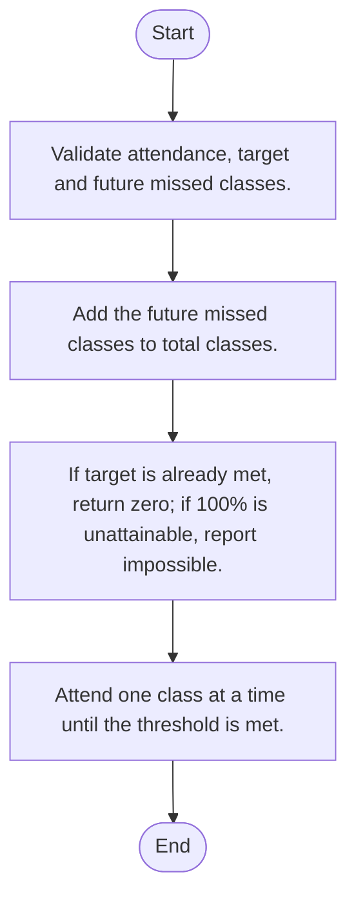
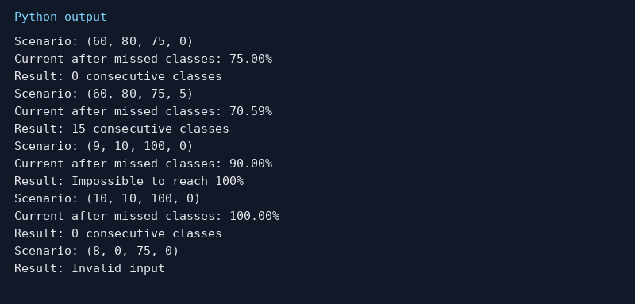

# Case Study 12: Attendance Recovery

**Name:** Srinija Dhanvi  
**Roll number:** 26000582

## Problem statement
Find the minimum consecutive attended classes needed to reach a target, including future missed classes.

## Objectives
- Apply computational thinking and the prescribed Python fundamentals to the problem.
- Validate data, compute results, and display understandable outcomes.

## Assumptions and rules
Total classes must be positive; attended cannot exceed total; target must be between 0 and 100. The scenario specifies missed classes before recovery. A target of 100% cannot be recovered after any absence.

## Algorithm
1. Validate attendance, target and future missed classes.
2. Add the future missed classes to total classes.
3. If target is already met, return zero; if 100% is unattainable, report impossible.
4. Attend one class at a time until the threshold is met.

## Flowchart


**Text equivalent:** Start → Validate attendance, target and future missed classes. → Add the future missed classes to total classes. → If target is already met, return zero; if 100% is unattainable, report impossible. → Attend one class at a time until the threshold is met. → End.

## Pseudocode
```text
FOR each attendance scenario
  IF attendance, total, target or missed classes are invalid
    PRINT invalid input
  ELSE
    ADD future missed classes to total
    IF target is 100 and attendance is below total
      PRINT impossible
    ELSE
      SET needed to 0
      WHILE attendance percentage is below target
        ADD 1 to attended, total and needed
      PRINT needed
END FOR
```

## Python source code
See [`solution.py`](solution.py). The sample inputs are defined near the top of the file; edit them to try other scenarios. Run `python solution.py`.

## Test cases
- (60, 80, 75, 0) → 0 classes
- (60, 80, 75, 5) → 15 classes
- (9, 10, 100, 0) → impossible
- (10, 10, 100, 0) → 0 classes
- (8, 0, 75, 0) → invalid

The program output is shown below.

## Output screenshot


## Conclusion
This program finds how many more classes a student needs to attend to reach the required percentage. It also shows when reaching 100% is not possible.
