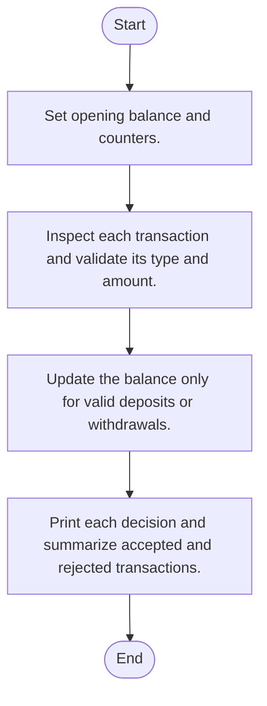
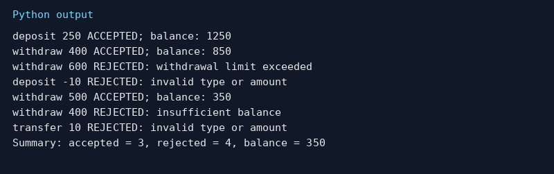

# Case Study 13: ATM Transaction Sequence

**Name:** Srinija Dhanvi  
**Roll number:** 26000582

## Problem statement
Simulate deposits and withdrawals and report accepted and rejected operations.

## Objectives
- Apply computational thinking and the prescribed Python fundamentals to the problem.
- Validate data, compute results, and display understandable outcomes.

## Assumptions and rules
Opening balance is ₹1,000; each withdrawal is limited to ₹500; amounts must be positive and withdrawals cannot exceed the balance. Unsupported transaction types are rejected.

## Algorithm
1. Set opening balance and counters.
2. Inspect each transaction and validate its type and amount.
3. Update the balance only for valid deposits or withdrawals.
4. Print each decision and summarize accepted and rejected transactions.

## Flowchart


**Text equivalent:** Start → Set opening balance and counters. → Inspect each transaction and validate its type and amount. → Update the balance only for valid deposits or withdrawals. → Print each decision and summarize accepted and rejected transactions. → End.

## Pseudocode
```text
SET opening balance, limit and counters
FOR each transaction
  IF type or amount is invalid, limit is exceeded,
     or withdrawal exceeds balance
    REJECT and count transaction
  ELSE
    ADD deposit or SUBTRACT withdrawal from balance
    COUNT accepted transaction
  PRINT decision
PRINT counters and balance
```

## Python source code
See [`solution.py`](solution.py). The sample inputs are defined near the top of the file; edit them to try other scenarios. Run `python solution.py`.

## Test cases
- Deposit 250 → balance 1250
- Withdraw 400 → balance 850
- Withdraw 600 → rejected (limit)
- Deposit -10 and transfer → rejected
- Withdraw 500 → balance 350; then withdraw 400 → insufficient balance

The program output is shown below.

## Output screenshot


## Conclusion
The program updates the account balance for valid transactions and rejects transactions that break the given rules.
