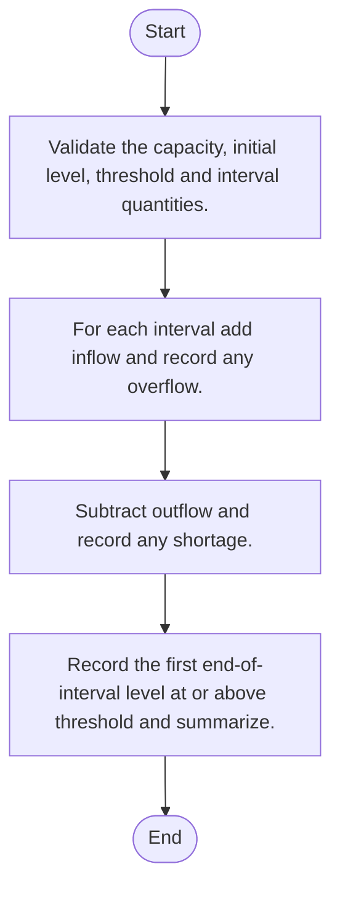
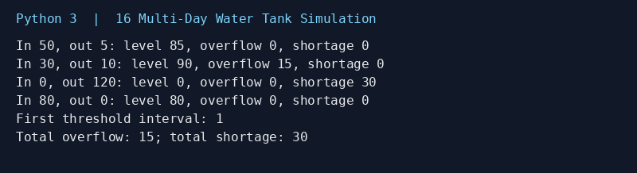

# Case Study 16: Multi-Day Water Tank Simulation

**Name:** Srinija Dhanvi  
**Roll number:** 26000582

## Problem statement
Simulate inflow and outflow, overflow, shortages and the first threshold interval.

## Objectives
- Apply computational thinking and the prescribed Python fundamentals to the problem.
- Validate data, compute results, and display understandable outcomes.

## Assumptions and rules
Capacity is 100 litres; opening level is 40 litres; threshold is 80 litres. Each interval applies inflow first and spills excess, then applies outflow; shortages are unmet outflow.

## Algorithm
1. Validate the capacity, initial level, threshold and interval quantities.
2. For each interval add inflow and record any overflow.
3. Subtract outflow and record any shortage.
4. Record the first end-of-interval level at or above threshold and summarize.

## Flowchart


**Text equivalent:** Start → Validate the capacity, initial level, threshold and interval quantities. → For each interval add inflow and record any overflow. → Subtract outflow and record any shortage. → Record the first end-of-interval level at or above threshold and summarize. → End.

## Pseudocode
```text
BEGIN
1. Validate the capacity, initial level, threshold and interval quantities.
2. For each interval add inflow and record any overflow.
3. Subtract outflow and record any shortage.
4. Record the first end-of-interval level at or above threshold and summarize.
END
```

## Python source code
See [`solution.py`](solution.py). The sample inputs are defined near the top of the file; edit them to try other scenarios. Run `python solution.py`.

## Test cases
- (50,5) → level 85; threshold interval 1
- (30,10) → overflow 15, level 90
- (0,120) → shortage 30, level 0
- (80,0) → level 80

The included program runs these examples. Actual console output is in [`output.txt`](output.txt); the image below is rendered directly from that output.

## Output screenshot


## Conclusion
This simulation shows how the tank level changes and reports overflow, shortage and the first interval reaching the threshold.
