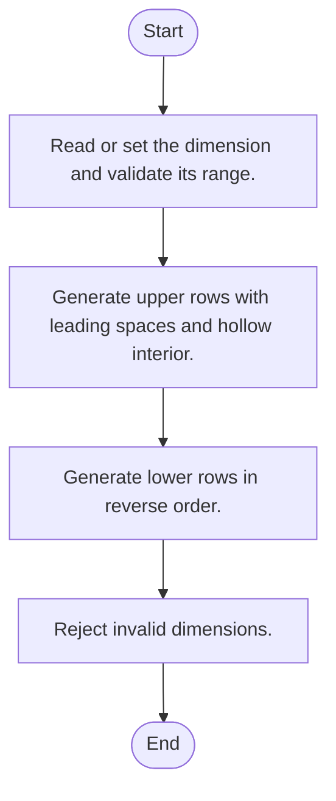
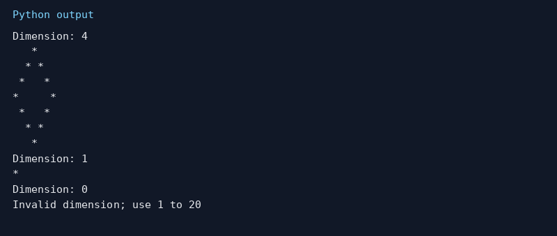

# Case Study 27: Hollow Diamond Pattern

**Name:** Srinija Dhanvi  
**Roll number:** 26000582

## Problem statement
Generate a properly aligned hollow diamond from a user-specified dimension.

## Objectives
- Apply computational thinking and the prescribed Python fundamentals to the problem.
- Validate data, compute results, and display understandable outcomes.

## Assumptions and rules
Dimension is an integer from 1 to 20, representing the upper half height including the middle row. Dimension 1 prints a single star. The example runs valid and invalid dimensions.

## Algorithm
1. Read or set the dimension and validate its range.
2. Generate upper rows with leading spaces and hollow interior.
3. Generate lower rows in reverse order.
4. Reject invalid dimensions.

## Flowchart


**Text equivalent:** Start → Read or set the dimension and validate its range. → Generate upper rows with leading spaces and hollow interior. → Generate lower rows in reverse order. → Reject invalid dimensions. → End.

## Pseudocode
```text
FOR each dimension
  IF dimension is outside 1 to 20
    PRINT invalid dimension
  ELSE
    FOR row from 1 to dimension
      PRINT leading spaces, stars and hollow spaces
    FOR row from dimension - 1 down to 1
      PRINT leading spaces, stars and hollow spaces
END FOR
```

## Python source code
See [`solution.py`](solution.py). The sample inputs are defined near the top of the file; edit them to try other scenarios. Run `python solution.py`.

## Test cases
- 4 → seven aligned rows
- 1 → one star
- 0 → invalid dimension

The program output is shown below.

## Output screenshot


## Conclusion
Using nested loops, the program prints a hollow diamond and checks whether the given size is valid.
