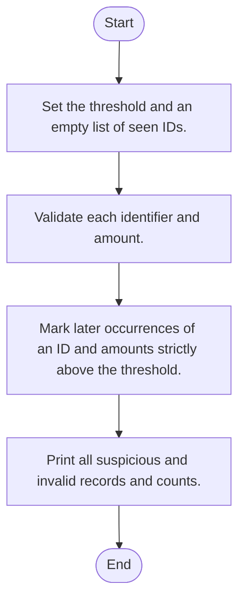
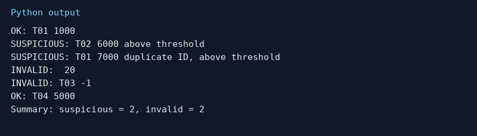

# Case Study 28: Repeated Transaction Detection

**Name:** Srinija Dhanvi  
**Roll number:** 26000582

## Problem statement
Detect duplicate transaction IDs and amounts over a specified threshold.

## Objectives
- Apply computational thinking and the prescribed Python fundamentals to the problem.
- Validate data, compute results, and display understandable outcomes.

## Assumptions and rules
IDs must be nonempty, amounts nonnegative, and the threshold is ₹5,000. Every occurrence after the first matching ID is a duplicate, irrespective of amount. Invalid entries are listed separately.

## Algorithm
1. Set the threshold and an empty list of seen IDs.
2. Validate each identifier and amount.
3. Mark later occurrences of an ID and amounts strictly above the threshold.
4. Print all suspicious and invalid records and counts.

## Flowchart


**Text equivalent:** Start → Set the threshold and an empty list of seen IDs. → Validate each identifier and amount. → Mark later occurrences of an ID and amounts strictly above the threshold. → Print all suspicious and invalid records and counts. → End.

## Pseudocode
```text
SET threshold and empty seen-ID list
FOR each transaction
  IF ID is blank or amount is negative
    PRINT invalid
  ELSE
    CHECK whether ID was seen before
    CHECK whether amount exceeds threshold
    PRINT all applicable reasons or OK
PRINT suspicious and invalid counts
```

## Python source code
See [`solution.py`](solution.py). The sample inputs are defined near the top of the file; edit them to try other scenarios. Run `python solution.py`.

## Test cases
- T02 ₹6000 → above threshold
- second T01 ₹7000 → duplicate and above threshold
- empty ID and negative amount → invalid
- ₹5000 → not above threshold

The program output is shown below.

## Output screenshot


## Conclusion
The program identifies repeated transaction IDs and amounts above the limit, while reporting invalid records separately.
