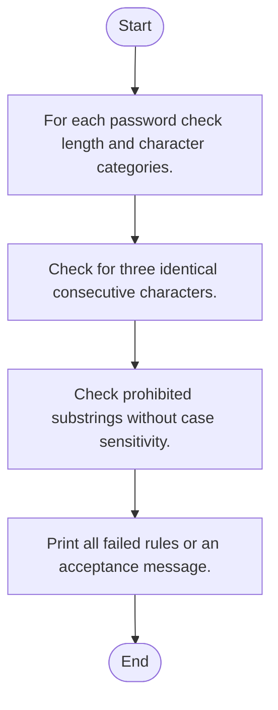
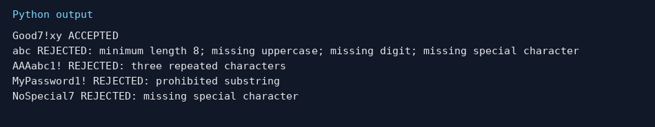

# Case Study 29: Password Policy Validation

**Name:** Srinija Dhanvi  
**Roll number:** 26000582

## Problem statement
Check passwords against multiple rules and report every failure.

## Objectives
- Apply computational thinking and the prescribed Python fundamentals to the problem.
- Validate data, compute results, and display understandable outcomes.

## Assumptions and rules
Minimum length is 8; require ASCII uppercase, lowercase, digit and one of !@#$%; three identical consecutive characters are prohibited; password and admin are prohibited substrings, case-insensitive. This is a policy demonstration, not secure password storage.

## Algorithm
1. For each password check length and character categories.
2. Check for three identical consecutive characters.
3. Check prohibited substrings without case sensitivity.
4. Print all failed rules or an acceptance message.

## Flowchart


**Text equivalent:** Start → For each password check length and character categories. → Check for three identical consecutive characters. → Check prohibited substrings without case sensitivity. → Print all failed rules or an acceptance message. → End.

## Pseudocode
```text
FOR each password
  CHECK minimum length
  SCAN characters for uppercase, lowercase, digit and special
  CHECK for three identical consecutive characters
  CHECK for prohibited substrings ignoring case
  PRINT every failed condition or accepted
END FOR
```

## Python source code
See [`solution.py`](solution.py). The sample inputs are defined near the top of the file; edit them to try other scenarios. Run `python solution.py`.

## Test cases
- Good7!xy → accepted
- abc → length and missing categories
- AAAabc1! → repeated characters
- MyPassword1! → prohibited substring
- NoSpecial7 → missing special

The program output is shown below.

## Output screenshot


## Conclusion
The program checks each password against the given rules and displays the reasons when it is rejected.
