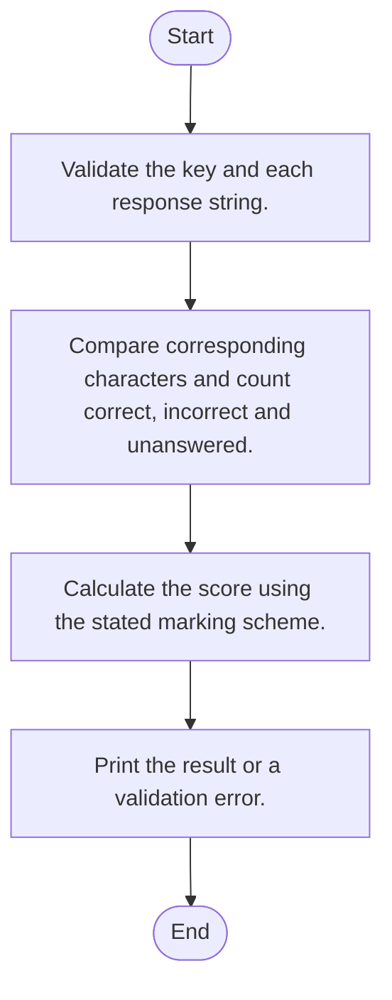
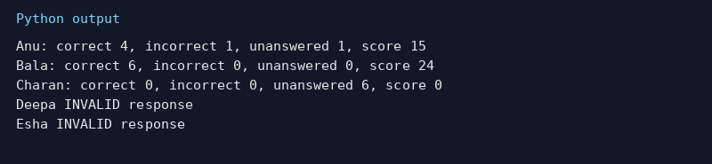

# Case Study 31: Examination Answer Evaluation

**Name:** Srinija Dhanvi  
**Roll number:** 26000582

## Problem statement
Compare answer strings to a key and compute results with negative marking.

## Objectives
- Apply computational thinking and the prescribed Python fundamentals to the problem.
- Validate data, compute results, and display understandable outcomes.

## Assumptions and rules
Key uses A–D; answers use A–D and - for unanswered; lengths must match. Correct answers earn 4 marks, incorrect answers lose 1, and unanswered answers earn 0. Scores may be negative.

## Algorithm
1. Validate the key and each response string.
2. Compare corresponding characters and count correct, incorrect and unanswered.
3. Calculate the score using the stated marking scheme.
4. Print the result or a validation error.

## Flowchart


**Text equivalent:** Start → Validate the key and each response string. → Compare corresponding characters and count correct, incorrect and unanswered. → Calculate the score using the stated marking scheme. → Print the result or a validation error. → End.

## Pseudocode
```text
VALIDATE the answer key
FOR each student response
  CHECK response length and characters
  IF invalid, print error
  ELSE compare each answer with the key
    COUNT correct, incorrect and unanswered
    SCORE = correct * 4 - incorrect
    PRINT counts and score
END FOR
```

## Python source code
See [`solution.py`](solution.py). The sample inputs are defined near the top of the file; edit them to try other scenarios. Run `python solution.py`.

## Test cases
- AB-DAC → 4 correct, 1 wrong, 1 unanswered, score 15
- ABCDAB → score 24
- ------ → score 0
- ABCXAB and AB → invalid

The program output is shown below.

## Output screenshot


## Conclusion
The program compares answers with the key and calculates marks using the stated negative marking rule.
