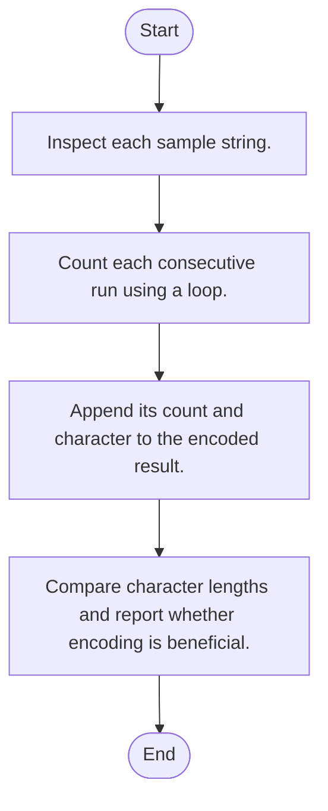
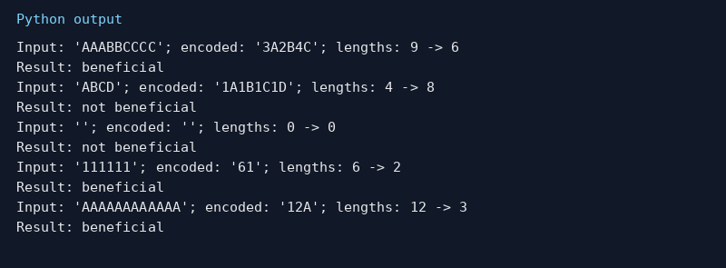

# Case Study 35: Character Run Compression

**Name:** Srinija Dhanvi  
**Roll number:** 26000582

## Problem statement
Encode consecutive character runs and compare encoded and original lengths.

## Objectives
- Apply computational thinking and the prescribed Python fundamentals to the problem.
- Validate data, compute results, and display understandable outcomes.

## Assumptions and rules
Each run is encoded as decimal count followed by the character, e.g. 3A2B. The encoded format is for display/length comparison only; no decoding is claimed because digits in the input would make this format ambiguous. Empty input stays empty.

## Algorithm
1. Inspect each sample string.
2. Count each consecutive run using a loop.
3. Append its count and character to the encoded result.
4. Compare character lengths and report whether encoding is beneficial.

## Flowchart


**Text equivalent:** Start → Inspect each sample string. → Count each consecutive run using a loop. → Append its count and character to the encoded result. → Compare character lengths and report whether encoding is beneficial. → End.

## Pseudocode
```text
FOR each string
  SET encoded text to empty
  WHILE characters remain
    COUNT the consecutive run of the current character
    APPEND count and character to encoded text
  COMPARE original and encoded lengths
  PRINT encoded text and whether it saves space
END FOR
```

## Python source code
See [`solution.py`](solution.py). The sample inputs are defined near the top of the file; edit them to try other scenarios. Run `python solution.py`.

## Test cases
- AAABBCCCC → 3A2B4C, 9 → 6
- ABCD → 1A1B1C1D, not beneficial
- empty → empty, not beneficial
- 12 As → 12A

The program output is shown below.

## Output screenshot


## Conclusion
The program groups repeated characters and compares the length of the compressed text with the original.
