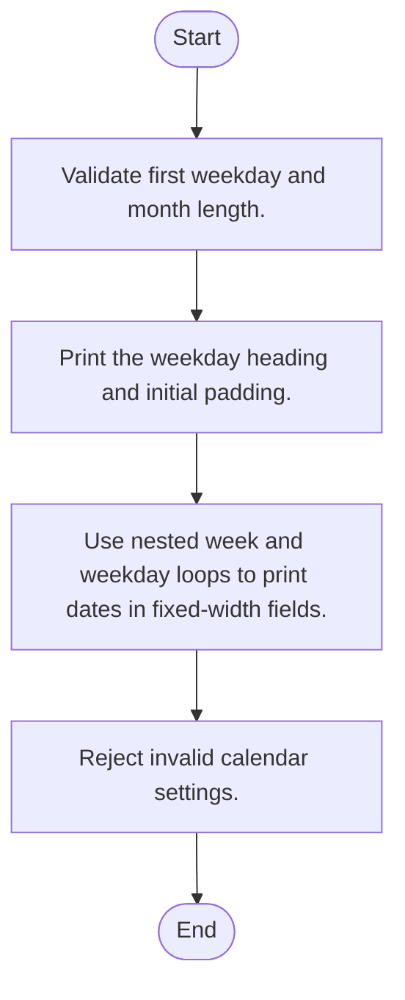
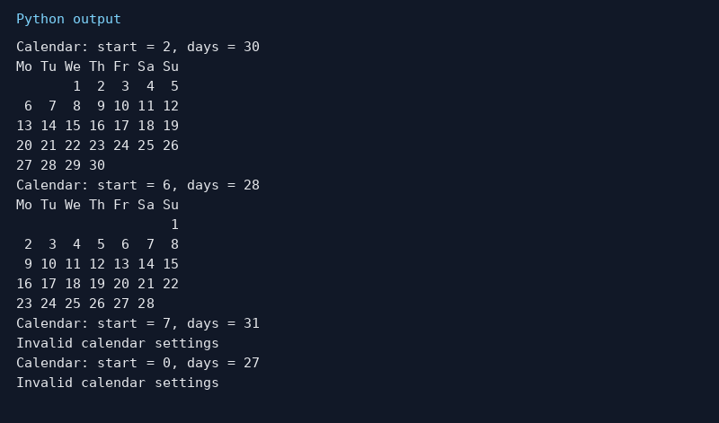

# Case Study 37: Monthly Calendar Generator

**Name:** Srinija Dhanvi  
**Roll number:** 26000582

## Problem statement
Generate a calendar using a supplied first weekday and number of days.

## Objectives
- Apply computational thinking and the prescribed Python fundamentals to the problem.
- Validate data, compute results, and display understandable outcomes.

## Assumptions and rules
Week starts Monday (0) through Sunday (6). Day count must be 28, 29, 30 or 31; the user supplies the valid combination for the intended month and year.

## Algorithm
1. Validate first weekday and month length.
2. Print the weekday heading and initial padding.
3. Use nested week and weekday loops to print dates in fixed-width fields.
4. Reject invalid calendar settings.

## Flowchart


**Text equivalent:** Start → Validate first weekday and month length. → Print the weekday heading and initial padding. → Use nested week and weekday loops to print dates in fixed-width fields. → Reject invalid calendar settings. → End.

## Pseudocode
```text
FOR each starting weekday and month length
  IF either value is invalid, print error
  ELSE print weekday heading
    WHILE dates remain
      FOR each weekday in a week
        ADD leading spaces or the next date
      PRINT the week
END FOR
```

## Python source code
See [`solution.py`](solution.py). The sample inputs are defined near the top of the file; edit them to try other scenarios. Run `python solution.py`.

## Test cases
- start 2, 30 days → day 1 under Wednesday
- start 6, 28 days → day 1 under Sunday
- start 7 → invalid
- 27 days → invalid

The program output is shown below.

## Output screenshot


## Conclusion
The program prints the dates in a calendar layout based on the given starting day and month length.
