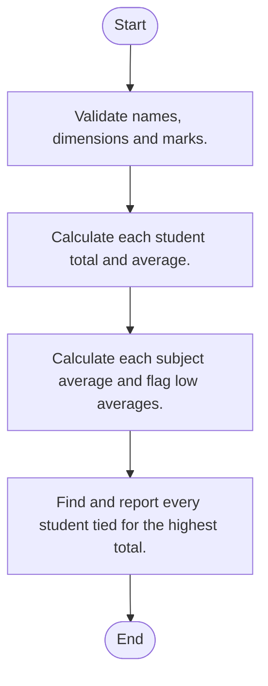
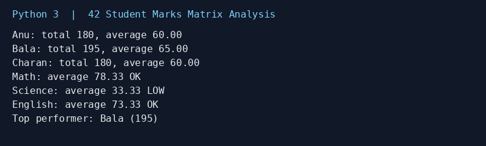

# Case Study 42: Student Marks Matrix Analysis

**Name:** Srinija Dhanvi  
**Roll number:** 26000582

## Problem statement
Calculate student and subject statistics, top performers and low-average subjects.

## Objectives
- Apply computational thinking and the prescribed Python fundamentals to the problem.
- Validate data, compute results, and display understandable outcomes.

## Assumptions and rules
Rows represent students and columns represent subjects. Marks are 0–100; pass/low-average threshold is 40. All rows must have the same number of marks. Tied top performers are all reported.

## Algorithm
1. Validate names, dimensions and marks.
2. Calculate each student total and average.
3. Calculate each subject average and flag low averages.
4. Find and report every student tied for the highest total.

## Flowchart


**Text equivalent:** Start → Validate names, dimensions and marks. → Calculate each student total and average. → Calculate each subject average and flag low averages. → Find and report every student tied for the highest total. → End.

## Pseudocode
```text
BEGIN
1. Validate names, dimensions and marks.
2. Calculate each student total and average.
3. Calculate each subject average and flag low averages.
4. Find and report every student tied for the highest total.
END
```

## Python source code
See [`solution.py`](solution.py). The sample inputs are defined near the top of the file; edit them to try other scenarios. Run `python solution.py`.

## Test cases
- Anu → total 180, average 60
- Bala → total 195, top performer
- Science → average 33.33, LOW
- Math and English → OK

The included program runs these examples. Actual console output is in [`output.txt`](output.txt); the image below is rendered directly from that output.

## Output screenshot


## Conclusion
The program calculates student totals and subject averages and identifies the top student and subjects with low averages.
